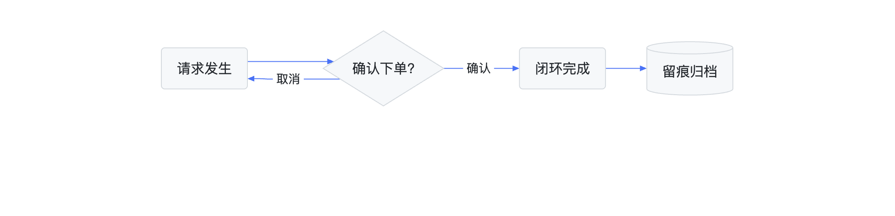
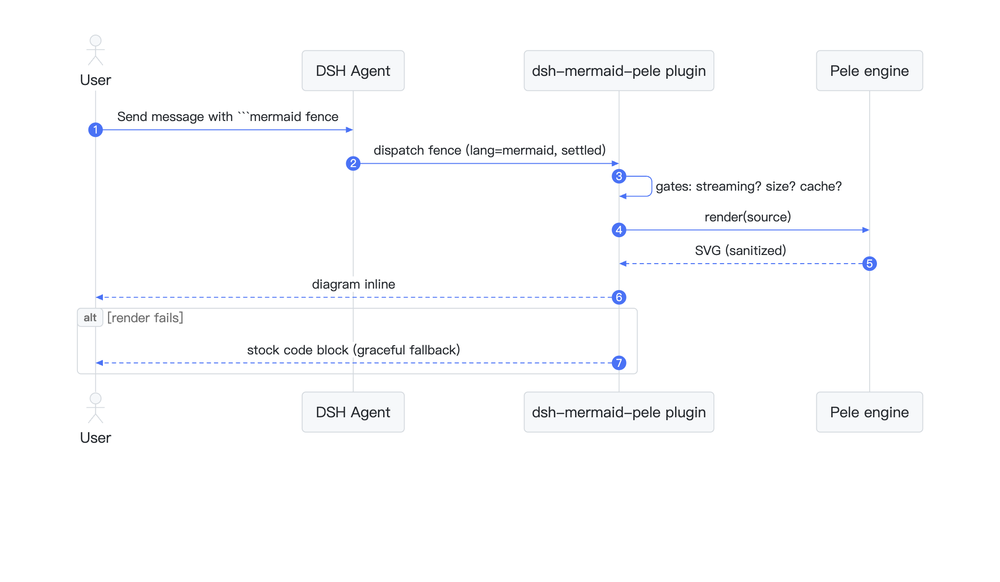
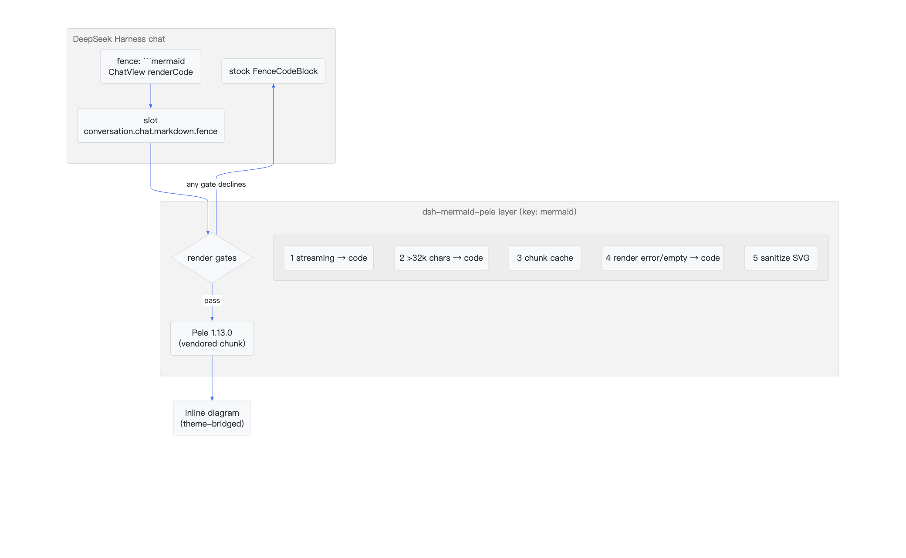
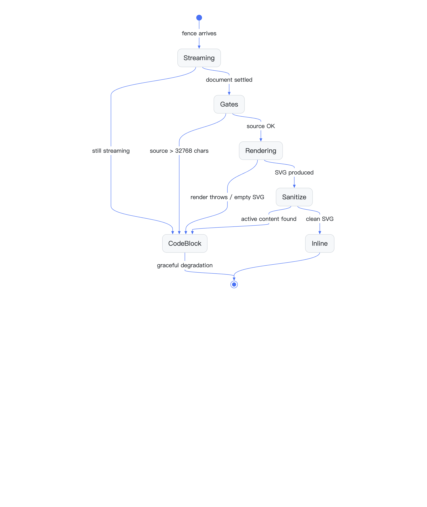
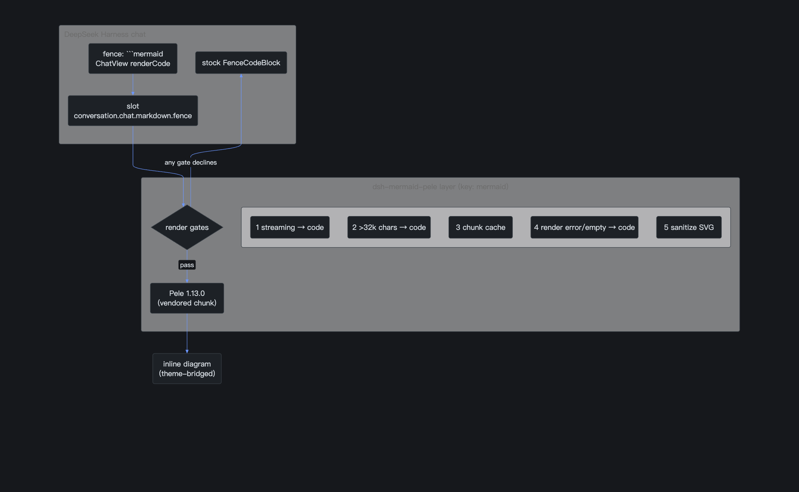

# dsh-mermaid-pele

**Any ` ```mermaid ` fence your model writes becomes a diagram — rendered by [Pele](https://github.com/obsidianmd/pele), the engine Obsidian ships.**

[](https://github.com/obsidianmd/pele)
[](https://github.com/deepseek-ai/deepseek-harness)
[](#requirements)
[](#security)
[](LICENSE)



English | [简体中文](README.zh-CN.md)

---

## Why

- **Zero effort.** The model just writes Mermaid — like it already does. There is no tool to call, no syntax to opt into, no context overhead. When the fence settles, the diagram is there.
- **Obsidian-grade rendering.** Pele is the declarative Mermaid→SVG renderer that Obsidian 1.15+ runs on untrusted vault content. It cannot execute code, is ~6× smaller than mermaid.js, and has no dependencies.
- **Never breaks the chat.** Every failure path — still streaming, oversized source, parse error, load failure — degrades to the ordinary code block. The worst case is always "source shown", never "message lost".

## What it does

DeepSeek Harness (DSH) renders assistant messages as Markdown but shows Mermaid source as a plain code block. This plugin registers a language-keyed layer on the official `conversation.chat.markdown.fence` slot: any fence tagged `mermaid` is handed to the vendored Pele build and drawn as inline SVG, themed by DSH's design tokens.

```text
Before:  ┌──────────────────────────────┐
         │ flowchart LR                 │
         │   A[请求发生] --> B{确认下单?} │   ← wall of source
         └──────────────────────────────┘

After:   ┌────┐    ┌────┐    ┌────┐    ┌────┐
         │请求 │───▶│确认?│───▶│完成 │───▶│留痕 │    ← the diagram
         └────┘    └────┘    └────┘    └────┘
```

## Quick start

```bash
# 1. clone into your profile's plugin directory
git clone https://github.com/Tazio7/dsh-mermaid-pele.git <workspace>/plugins/dsh-mermaid-pele

# 2. register it on the profile
dsh plugin --profile <profile-name> add <workspace>/plugins/dsh-mermaid-pele

# 3. restart DSH, then ask your model for a mermaid diagram. done.
```

Details and the patch-row shape: [Install](#install). No config, no secrets, nothing to tune.

## Gallery

| | |
|---|---|
|  |  |
|  |  |

Light and dark share one SVG — colors come from CSS variables bridged to DSH's `--dsw-alias-*` tokens, so flipping the theme never re-renders anything.

## How it works

Fences dispatch through DSH's `conversation.chat.markdown.fence` slot by language. This plugin adds a `mermaid` layer that runs five gates before drawing — any gate that declines simply keeps the stock code block:

1. streaming → keep source (a half-written diagram cannot parse)
2. source > 32,768 chars → keep source
3. renderer loads once per page from a package-local chunk (cached)
4. render throws or returns empty → keep source
5. sanitize the SVG (`script` / `foreignObject` / `iframe` / `object` / `embed` / `image` / `use`, `on*` handlers, `javascript:` / `vbscript:` / `data:` URLs removed) → replace into the DOM


## Requirements

| | |
|---|---|
| DeepSeek Harness | `0.2.2-rc.5` (tested); anything with the `conversation.chat.markdown.fence` slot should work |
| Surface | Web GUI / desktop app chat — assistant messages |
| Build tools | **none** |
| Runtime network | **none** |

Not applicable to the terminal CLI (no chat UI there). Composer input and user-message bubbles are out of scope for v1.

## Install

1. **Get the plugin into your profile's plugin directory** (default layout: `<workspace>/plugins/`):

   ```bash
   git clone https://github.com/Tazio7/dsh-mermaid-pele.git \
     <your-workspace>/plugins/dsh-mermaid-pele
   ```

2. **Register it on the profile** — either through the CLI:

   ```bash
   dsh plugin --profile <profile-name> add <path-to>/dsh-mermaid-pele
   ```

   or by adding the bundle row via the plugin's `cordis.patch.yml` (shape below) through your profile's bundle configuration.

3. **Restart DSH / open a new session** and paste this into a chat:

   ````text
   ```mermaid
   flowchart LR
     A[Request raised] --> B{Confirmed?}
     B -- yes --> C[Order placed]
     B -- no --> A
     C --> D[Closed loop + audit trail]
   ```
   ````

   You should see a rendered flowchart. If you see the source code block instead, see [Troubleshooting](#troubleshooting).

### The patch row (what registration looks like)

```yaml
# cordis.patch.yml — bundle patch applied over the profile when this package
# is listed in dsh.profile.bundles. The package name must match package.json.
- insert:
    - id: mermaid
      name: 'dsh-mermaid-pele'
      config: {}
```

No secrets, no endpoints, no config keys — the `config` object is intentionally empty.

## Usage

Nothing to do: ask the assistant for a Mermaid diagram (or paste one), and any ` ```mermaid ` fence in its reply renders as SVG.

Supported syntax follows **Pele 1.13.0**, which implements the **Mermaid 12.1.0** syntax surface: flowchart, sequence, class, state, ER, gantt, pie, mindmap, timeline, treemap and friends. Anything Pele cannot parse stays as a readable source block.

## Security

Model output is untrusted input. The render path stacks three independent defenses:

1. **Pele cannot execute code.** It is a declarative syntax→SVG renderer ("Pele can't run code") — the same engine Obsidian trusts for untrusted vault content.
2. **Output sanitization.** The produced SVG is parsed and re-built before DOM insertion: `script`, `foreignObject`, `iframe`, `object`, `embed`, `image`, `use` elements, `on*` event attributes, and `javascript:` / `vbscript:` / `data:` URLs are removed.
3. **Size cap.** Sources larger than 32,768 characters are never rendered — shown as source instead.

No credentials, no storage, no telemetry, no outbound requests. See [SECURITY.md](SECURITY.md) for the full model and how to report issues.

## Versioning & the Pele pin

Each plugin release ships **exactly one** Pele build, vendored at `lib/vendor/pele.global.js`:

| Plugin | Vendored Pele | Pele source | sha256 |
|---|---|---|---|
| `0.1.0` (planned) | `1.13.0` | [obsidianmd/pele releases](https://github.com/obsidianmd/pele/releases) | `0b0a46c57a5a6971670c09f5ec4066705bd78505f90fd11adf6260325efa0910` |

Pele never updates inside a released plugin version. Upgrading Pele means cutting a new plugin release, following the checklist in [CONTRIBUTING.md](CONTRIBUTING.md) (download → hash → swap → bump → smoke-test). This keeps renderer and glue code matching by construction.

## Compatibility matrix

| Plugin | DSH tested | Pele vendored | Status |
|---|---|---|---|
| `0.1.x` | `0.2.2-rc.5` | `1.13.0` | planned |

The fence slot API is pre-1.0 DSH surface; a DSH upgrade that reshapes the slot contract will get a matching plugin minor release. In every case the failure mode is "falls back to code block", not breakage.

## Troubleshooting

| Symptom | Likely cause |
|---|---|
| Always a code block | Plugin not activated — check `dsh plugin --profile <name> list`; look for `mermaid` in the boot log |
| Diagram appears only after the reply finishes | By design (streaming gate) |
| Very large diagram stays source | The 32,768-char cap |
| Wrong colors in one theme | Theme bridge reads `--dsw-alias-*`; custom DSH themes overriding those aliases will carry through |

## FAQ

**Why Pele instead of mermaid.js?**
Pele is ~6× smaller, faster, has zero dependencies, is CSS-variable themeable, is MIT-licensed, and is field-proven on untrusted input by Obsidian 1.15+. It is also the same renderer your Obsidian vault uses, so diagrams look identical across tools.

**Does it render in my own messages or the composer?**
No — v1 covers assistant messages only.

**Does it send anything anywhere?**
No. After install, the plugin performs zero network I/O.

**Why did my diagram show as source code once, then render on retry?**
The first pass hit the streaming gate or a transient load ordering issue; once the fence is final the layer renders it.

## Contributing

See [CONTRIBUTING.md](CONTRIBUTING.md). The smoke-test set doubles as the acceptance checklist.

## License

[MIT](LICENSE) for the plugin code. Vendored [Pele](https://github.com/obsidianmd/pele) is MIT © 2026 kepano (includes one Lucide icon, ISC © 2026 Lucide Icons and Contributors) — see [NOTICE](NOTICE). Mermaid syntax compatibility is courtesy of Mermaid's MIT-licensed grammar.
