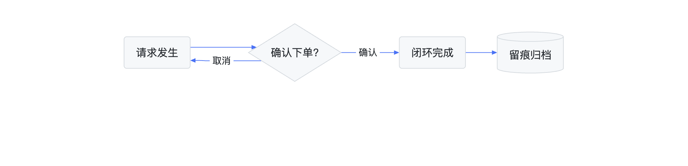
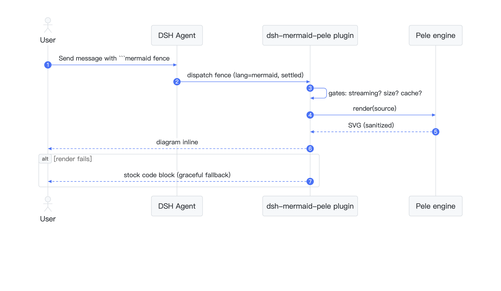
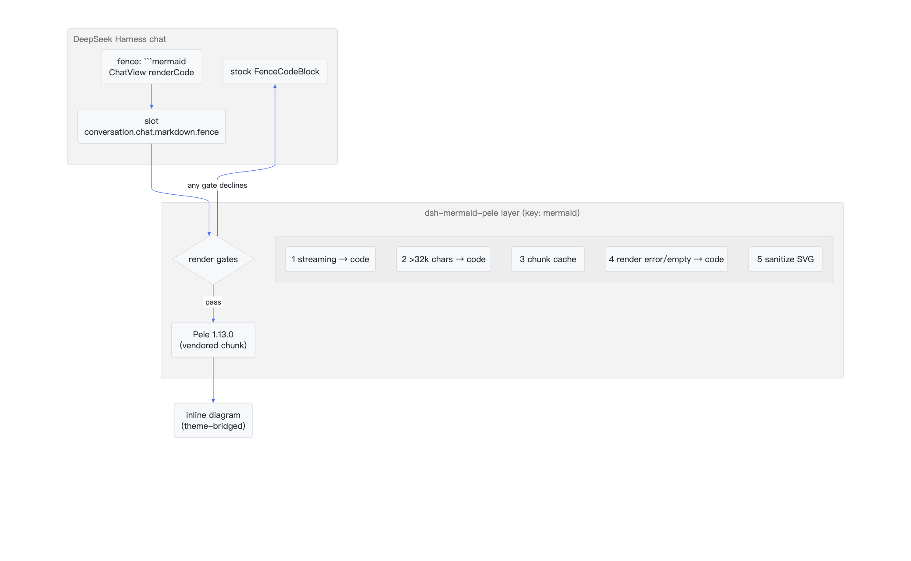
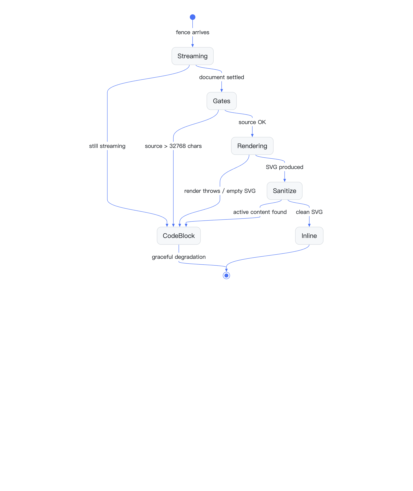
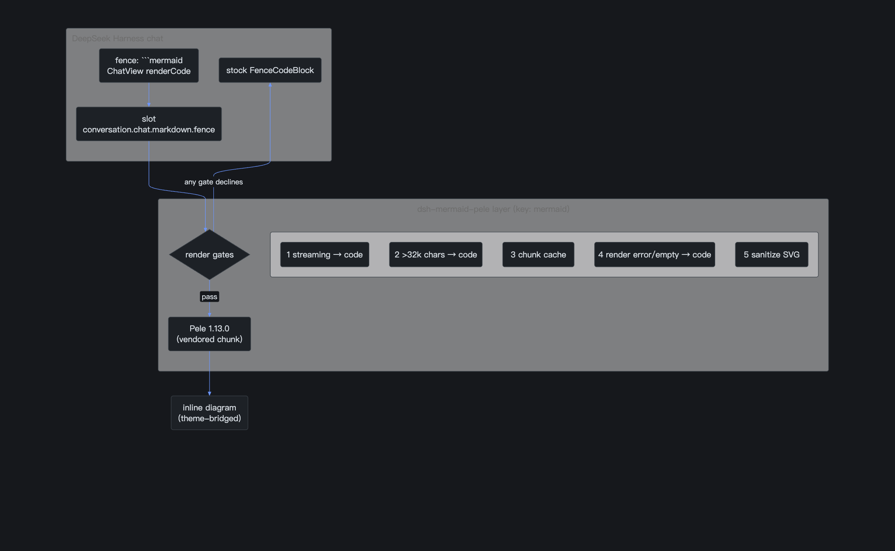

# dsh-mermaid-pele

**模型写下的每一个 ` ```mermaid ` 围栏，自动变成图——由 [Pele](https://github.com/obsidianmd/pele) 渲染，Obsidian 内置的同款引擎。**

[](https://github.com/obsidianmd/pele)
[](https://github.com/deepseek-ai/deepseek-harness)
[](#%E8%A6%81%E6%B1%82)
[](#%E5%AE%89%E5%85%A8)
[](LICENSE)



简体中文 | [English](README.md)

---

## 为什么

- **零成本。** 模型只需要像平常一样写 Mermaid——不用调用任何工具，不用学新语法，不占一点上下文。围栏落定，图就在那里。
- **Obsidian 级渲染引擎。** Pele 是 Obsidian 1.15+ 用于渲染不可信内容的声明式 Mermaid→SVG 引擎：不能执行代码，体积约为 mermaid.js 的 1/6，零依赖。
- **永不弄坏会话。** 每条失败路径——流式生成中、源码超长、解析错误、加载失败——都降级为普通代码块。最坏结果永远是"显示源码"，而不是"消息损坏"。

## 它做什么

DeepSeek Harness（DSH）把助手消息按 Markdown 渲染，但 Mermaid 源码只显示为普通代码块。本插件在官方 `conversation.chat.markdown.fence` slot 上注册一个语言键控图层：任何标记为 `mermaid` 的围栏都会交给内置的 Pele 构建，绘制成内联 SVG，配色跟随 DSH 设计令牌。

```text
之前:  ┌──────────────────────────────┐
       │ flowchart LR                 │
       │   A[请求发生] --> B{确认下单?} │   ← 一墙源码
       └──────────────────────────────┘

之后:  ┌────┐    ┌────┐    ┌────┐    ┌────┐
       │请求 │───▶│确认?│───▶│完成 │───▶│留痕 │    ← 就是这张图
       └────┘    └────┘    └────┘    └────┘
```

## 快速开始

```bash
# 1. 克隆到 profile 的插件目录
git clone https://github.com/Tazio7/dsh-mermaid-pele.git <workspace>/plugins/dsh-mermaid-pele

# 2. 注册到 profile
dsh plugin --profile <profile-name> add <workspace>/plugins/dsh-mermaid-pele

# 3. 重启 DSH，然后让模型画一张 mermaid 图。完成。
```

细节与 patch 行格式见[安装](#安装)。无需配置、无密钥、无可调参数。

## 图库

| | |
|---|---|
|  |  |
|  |  |

深浅主题共用同一份 SVG——颜色来自桥接到 DSH `--dsw-alias-*` 令牌的 CSS 变量，切换主题不需要重新渲染任何东西。

## 工作原理

DSH 按 fence 语言把围栏派发到 `conversation.chat.markdown.fence` slot。本插件添加一个 `mermaid` 图层，绘制前过五道门——任何一道不通过，就保留原生代码块：

1. 流式生成中 → 保留源码（半截的图无法解析）
2. 源码超过 32,768 字符 → 保留源码
3. 渲染器按页面从包内 chunk 加载一次（带缓存）
4. 渲染抛错或返回空 → 保留源码
5. 对 SVG 消毒（移除 `script` / `foreignObject` / `iframe` / `object` / `embed` / `image` / `use`、`on*` 事件属性、`javascript:` / `vbscript:` / `data:` URL）→ 替换进 DOM


## 要求

| | |
|---|---|
| DeepSeek Harness | `0.2.2-rc.5`（已实测）；具备 `conversation.chat.markdown.fence` slot 的版本应均可 |
| 界面 | Web GUI / 桌面端聊天——助手消息 |
| 构建工具 | **无** |
| 运行时网络 | **无** |

终端 CLI 不适用（无聊天界面）。输入框与用户消息气泡不在 v1 范围内。

## 安装

1. **把插件放进 profile 的插件目录**（默认布局：`<workspace>/plugins/`）：

   ```bash
   git clone https://github.com/Tazio7/dsh-mermaid-pele.git \
     <your-workspace>/plugins/dsh-mermaid-pele
   ```

2. **注册到 profile**——两种方式任选：

   通过 CLI：

   ```bash
   dsh plugin --profile <profile-name> add <path-to>/dsh-mermaid-pele
   ```

   或通过本插件 `cordis.patch.yml`（格式见下）在你的 profile bundle 配置中加一行。

3. **重启 DSH / 开新会话**，把下面这段贴进聊天：

   ````text
   ```mermaid
   flowchart LR
     A[请求发生] --> B{确认下单?}
     B -- 是 --> C[闭环完成]
     B -- 否 --> A
     C --> D[留痕归档]
   ```
   ````

   应该看到渲染出的流程图。如果仍是源码块，见[故障排查](#故障排查)。

### patch 行（注册形态）

```yaml
# cordis.patch.yml — 当本包列入 dsh.profile.bundles 时，bundle patch 覆盖应用到 profile。
# 包名必须与 package.json 一致。
- insert:
    - id: mermaid
      name: 'dsh-mermaid-pele'
      config: {}
```

无密钥、无端点、无配置项——`config` 对象有意留空。

## 使用

无需任何操作：让助手画 Mermaid 图（或贴一段），回复中的 ` ```mermaid ` 围栏自动渲染为 SVG。

支持语法跟随 **Pele 1.13.0**，它实现 **Mermaid 12.1.0** 语法面：flowchart、sequence、class、state、ER、gantt、pie、mindmap、timeline、treemap 等。Pele 解析不了的内容保持为可读源码块。

## 安全

模型输出是不可信输入。渲染路径叠加三层独立防御：

1. **Pele 不能执行代码。** 它是声明式的语法→SVG 渲染器（"Pele can't run code"）——Obsidian 用于不可信内容的正是同一引擎。
2. **输出消毒。** 产出的 SVG 在插入 DOM 前先解析重建：移除 `script`、`foreignObject`、`iframe`、`object`、`embed`、`image`、`use` 元素、`on*` 事件属性、`javascript:` / `vbscript:` / `data:` URL。
3. **体积上限。** 超过 32,768 字符的源码一律不渲染——按源码显示。

不存凭证、不落存储、无遥测、无出站请求。完整模型与报告渠道见 [SECURITY.md](SECURITY.md)。

## 版本与 Pele 钉定

每个插件 release 只随附**一个** Pele 构建，内置于 `lib/vendor/pele.global.js`：

| 插件版本 | 内置 Pele | Pele 来源 | sha256 |
|---|---|---|---|
| `0.1.0`（计划） | `1.13.0` | [obsidianmd/pele releases](https://github.com/obsidianmd/pele/releases) | `0b0a46c57a5a6971670c09f5ec4066705bd78505f90fd11adf6260325efa0910` |

已发布的插件版本内 Pele 永不自动更新。升级 Pele = 发布新的插件版本，遵循 [CONTRIBUTING.md](CONTRIBUTING.md) 的清单（下载 → 哈希 → 替换 → bump → 冒烟测试）。这保证渲染器与胶水代码天然匹配。

## 兼容矩阵

| 插件版本 | 实测 DSH | 内置 Pele | 状态 |
|---|---|---|---|
| `0.1.x` | `0.2.2-rc.5` | `1.13.0` | 计划中 |

fence slot API 属于 DSH 1.0 前的表面；若 DSH 升级改变了 slot 契约，会发布匹配的插件次版本。任何情况下失败模式都是"降级为代码块"，而不是坏掉。

## 故障排查

| 症状 | 可能原因 |
|---|---|
| 始终是代码块 | 插件未激活——检查 `dsh plugin --profile <name> list`；在启动日志中找 `mermaid` |
| 回复结束后才出图 | 设计如此（流式门） |
| 超大图保持源码 | 32,768 字符上限 |
| 某主题下配色不对 | 主题桥读取 `--dsw-alias-*`；覆盖这些别名的自定义 DSH 主题会被带入 |

## FAQ

**为什么用 Pele 而不是 mermaid.js？**
Pele 体积约为 1/6、更快、零依赖、支持 CSS 变量主题化、MIT 协议，且已被 Obsidian 1.15+ 在不可信输入上大量验证。它也是你 Obsidian 库里的同一渲染器，图在两边长得一模一样。

**会渲染我自己的消息或输入框吗？**
不会——v1 只覆盖助手消息。

**会向外发送任何东西吗？**
不会。安装后插件零网络 I/O。

**为什么图有一次显示为源码，重试又渲染了？**
第一次触发了流式门或加载顺序的暂时性问题；围栏定稿后图层会渲染它。

## 参与

见 [CONTRIBUTING.md](CONTRIBUTING.md)。冒烟测试集兼作验收清单。

## 许可

插件代码采用 [MIT](LICENSE)。内置 [Pele](https://github.com/obsidianmd/pele) 为 MIT © 2026 kepano（含一枚 Lucide 图标，ISC © 2026 Lucide Icons and Contributors）——见 [NOTICE](NOTICE)。Mermaid 语法兼容得益于 Mermaid 的 MIT 语法实现。
